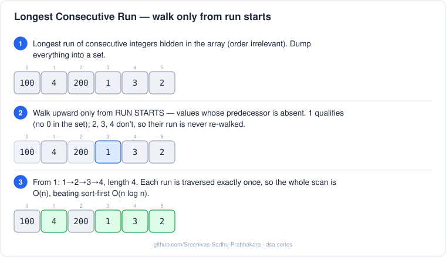

# Longest Consecutive Sequence

> Striver SDE Sheet 021 · Day 4 Arrays — hash set, but only walk a run from its true start, so every element is visited at most twice. Go, stdlib only, tested.

## Problem

Given an unsorted array, find the length of the longest sequence of consecutive integers that all appear in it (the elements need not be adjacent in the array). Target O(n) — sorting first would be the lazy O(n log n) fallback.

## Approach

Put everything in a set. The naive "walk upward from every element" is O(n²) on a long run; the fix is one guard: only start walking from values whose predecessor is absent — the genuine starts of runs. Then each run is traversed exactly once no matter how many of its members the outer loop touches, making the whole thing amortized linear. Duplicates vanish into the set for free.

**Complexity:** O(n) time, O(n) space.

## Visual walkthrough

Read the picture top to bottom — each numbered frame is one moment of the algorithm
running on this repo's test example.

## Run

    go test ./...   # verify
    go run .        # demo

---

One of 191 repos solving Striver's SDE Sheet in Go — stdlib only, one problem per repo, every solution tested. Browse the set: [`dsa-*` repos](https://github.com/Sreenivas-Sadhu-Prabhakara?tab=repositories&q=dsa-&type=source).
